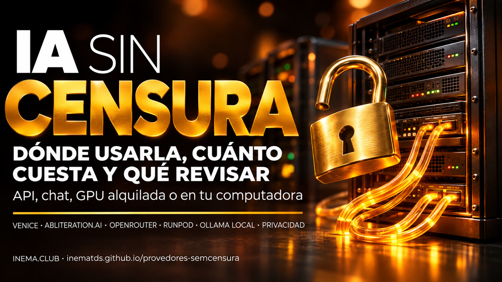

# provedores-semcensura

**🇧🇷 [Português](README.md) · 🇺🇸 [English](README.en.md) · 🇪🇸 [Español](README.es.md)**

## Qué es

Esta guía muestra dónde encontrar modelos de IA “sin censura”, es decir, versiones que no rechazan solicitudes. Es para quienes prueban la seguridad de su propio sistema, investigan o simplemente quieren un asistente que no se bloquee con temas delicados. En una tabla puedes ver proveedores por API, chat, GPU alquilada y en tu propio computador, con precios, privacidad declarada y si solicitan identificación. Para usarla, basta con leer; los ejemplos requieren una cuenta en el proveedor elegido o tener Ollama instalado.

## 📖 Guía de uso

Guía completa (landing + paso a paso): **https://inematds.github.io/provedores-semcensura/guia/es/**

## Qué incluye la guía

- Diferencias entre **uncensored** (fine-tune, como Dolphin), **abliterated** (elimina la “dirección de rechazo” de los pesos, sin entrenar) y **jailbroken** (un prompt que engaña las reglas), y qué se pierde al quitar el bloqueo.
- Cómo encontrar estos modelos en Hugging Face.
- Tabla comparativa: Venice, abliteration.ai, orcarouter (Ollama), OpenRouter, Featherless, RunPod y local con Ollama: tipo, modelos, precio (verificado el 09/11/2026), identidad, privacidad declarada y compatibilidad con OpenAI.
- “Cuál elegir” según la situación.
- Paso a paso: Venice mediante una API compatible con OpenAI, modelo local con Ollama y cómo conectarlo a un harness de agente.
- A dónde van tus datos y cómo usarlo de forma responsable.

Nada de esto se probó con una cuenta o clave: los datos provienen de las páginas públicas de los proveedores; lo que no se pudo confirmar aparece como “no confirmado”.

## El proceso, de principio a fin

Leyenda: 🧠 sesión con Nei · ⚙️ script · 🤖 `claude -p` / agente

1. 🧠 **Investigación** de las páginas públicas de los proveedores (solo lectura, sin cuenta ni API) → `~/projetos/output/provedores-semcensura/PESQUISA.md`, con lo que no se confirmó.
2. ⚙️ **Portada** del catálogo + arte crudo de la hero: `node ~/.claude/skills/capa-inema/assets/gerar-capa.cjs --repo . --title "Provedores de IA sem censura" --cat "IA" --save-raw guia/assets/hero.png --gerador auto` → `capa/capa.png`.
3. ⚙️ **Banners** (Codex image_gen mediante la suscripción), 2 estilos × 3 idiomas: `bash ~/.claude/skills/projetos-landing-guia/assets/gerar-banner.sh --repo . --title "IA SEM CENSURA" --destaque "CENSURA" ...` (`--estilo grade --saida banner-grade`, `--lang en|es --saida banner-en|banner-es`...). Revisar el texto dibujado.
4. 🧠 **Guía en PT** en `guia/index.html` (skill `projetos-landing-guia`), solo con datos de la investigación.
5. 🤖 **Traducción** EN/ES con el traductor central: `inema-traduz -o out-en.html < prompt-en.txt` → `guia/en/index.html` y `guia/es/index.html`.
6. 🤖 **Revisión independiente** por otro agente (con la perspectiva de alguien que nunca vio el proyecto).
7. ⚙️ **Publicar**: `git push` → GitHub Actions (`.github/workflows/pages.yml`) publica en Pages; verificar que responda 200 en `/guia/`, `/guia/en/`, `/guia/es/`.
8. 🧠 **Actualizar precios**: repetir el paso 1 y cambiar la fecha “verificado el” en la guía y los READMEs.

## Relacionados en INEMA

- [IA privada en 3 niveles](https://inematds.github.io/ia-privada-3-niveis/guia/es/)
- [IA sin censura defensiva](https://inematds.github.io/ia-sem-censura-defensiva/guia/es/)

---

Contenido abierto de [INEMA.CLUB](https://inema.club). Úsalo con responsabilidad: quitar el bloqueo del modelo no elimina la ley.